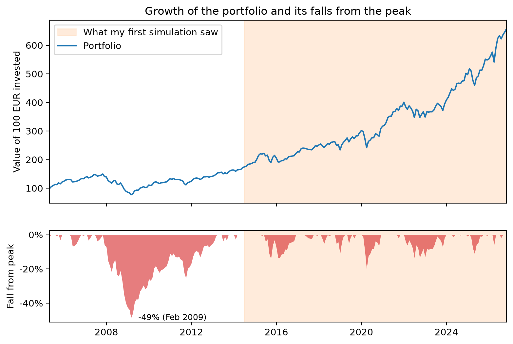

"Invest your money!", "Invest in the S&P 500!", "Don't leave your money sitting in cash!", ... You've probably heard this kind of advice before on social media or from friends. Ok, but why? What are the numbers behind these statements? If I start putting money into a portfolio, I want to know how much risk I'm taking and how much I can realistically expect to get back. So before learning anything else about investing, I decided to simulate a simple portfolio and see what the data says.

The catch is that the honest answer isn't a single number. Markets don't return 7% every year, so instead of one future I generated 10,000 of them from what markets have actually done in the past. This episode is about how I built the simulation, everything I had to fix to make it honest, and what the numbers looked like at the end.

## The setup

Before getting to any results, here's what I simulated and how the simulation works.

### The portfolio

Since I wanted to be able to alternate between different portfolios to experiment, I built the tool as a Jupyter notebook which picks up the portfolio configuration from a TOML file. The configuration includes the asset allocation, monthly contribution, and simulation length, etc. To keep it simple, I use a portfolio of only three ETFs:

| Fund | What it holds | ISIN | Ticker | Share of each contribution |
| --- | --- | --- | --- | --- |
| iShares Core MSCI World UCITS ETF (Acc) | Large and mid caps across 23 developed countries | IE00B4L5Y983 | EUNL.DE | 70% |
| iShares Core MSCI EM IMI UCITS ETF (Acc) | Large, mid and small caps across emerging markets | IE00BKM4GZ66 | IS3N.DE | 20% |
| iShares Core MSCI Europe UCITS ETF (Acc) | Large and mid caps across developed European countries | IE00B4K48X80 | EUNK.DE | 10% |

> **What's an ETF?**
>
> An ETF (exchange-traded fund) is a basket of many companies' shares that you buy as a single product on a stock exchange, just like you'd buy one share. An *index* ETF doesn't try to pick winners: it simply copies an index, a list of companies chosen by fixed rules. The MSCI World, for example, holds over a thousand large and mid-sized companies from developed countries. So one purchase spreads your money across all of them.
>
> A few terms you'll see in the table:
>
> - **ISIN**: the fund's unique ID, the same on every exchange. **Ticker**: its short code on one particular exchange.
> - **Accumulating (Acc)**: dividends are reinvested inside the fund instead of being paid out to you.

The plan is the most boring one possible: let's say I start from 0 € and put 200 € into this portfolio every month for 10 years. I don't touch it, I don't rebalance it, I just let it sit there. I run the simulation 10,000 times to see what could happen.

| Setting | Value |
| --- | --- |
| Monthly contribution | 200 € |
| Horizon | 10 years |
| Starting balance | 0 € |
| Simulated futures | 10,000 |

### How to simulate future that hasn't happened

I can't know what markets will do over the next ten years. But I do have about twenty years of what they did do, month by month. So the idea is to use the past as a menu: build each possible future by picking pieces of real history at random.

The simplest version picks 120 random months (12 months * 10 years) and chains them together. The problem is that markets have memory, at least in the short term. Crashes don't come as one bad month surrounded by good ones; they come in streaks. For instance, in the 2008 crisis the market fell month after month. Should you shuffle single months, then those streaks disappear, and the future looks calmer than the past ever was.

So instead I pick **blocks** of consecutive months. This is called a *block bootstrap*:

1. Pick a random starting month in the history and take it plus the next two: a 3-month block.
2. Repeat until there are 120 months (40 blocks).
3. That's one possible decade. Do it 10,000 times.

One of those futures might start with the spring of 2009, jump to the end of 2017, then land on the COVID crash of early 2020. Each block is a real stretch of market history; only the order is new.

One more detail matters: each month is taken *for all three funds at once*. If I picked them separately, emerging markets could boom while the rest of the world crashes in the same simulated month. Keeping whole months together keeps the funds moving together the way they really do.

Each simulated month then does two things: put in €200 (split as I described before), and grow everything by that month's returns. In code:

```python
rng = np.random.default_rng(seed)
n_blocks = -(-n_months // block_size)  # 120 months / 3 = 40 blocks (rounded up)

# A random starting month for every block of every path...
starts = rng.integers(0, n_hist_months - block_size + 1, size=(n_paths, n_blocks))
# ...expanded into block_size consecutive months
month_idx = (starts[:, :, None] + np.arange(block_size)).reshape(n_paths, -1)[:, :n_months]

V = np.tile(initial_values, (n_paths, 1)).astype(float)  # one row per future, one column per fund
contribution = monthly_contribution * contribution_weights  # €200 → €140 / €40 / €20

for t in range(n_months):
    V += contribution                          # pay in at the start of the month
    V *= 1 + monthly_returns[month_idx[:, t]]  # then grow by that month's real returns
```

There's no loop over the 10,000 futures: NumPy moves all of them forward one month at a time, so the whole simulation runs in about a second.

Why 3 months? It's a trade-off. Longer blocks keep more of the real streaks, but there are fewer distinct ways to combine them, so the futures start to look like copies of the past. Three months is a compromise, and I'll come back to what it might be hiding.

## My first answer was too good

My first version only used the ETFs' own price history. That sounds like the obvious choice: if I'm simulating these three funds, I should use what these three funds actually did. The catch is that a simulation can only use months where *all* the funds have data, so the youngest one decides where history starts. The emerging markets ETF only has prices from June 2014, so my history ran from July 2014 to October 2026: 148 months.

The result looked great. Out of 10,000 futures, the median ended at **about €43,700** from €24,000 put in, and only **0.9%** of them ended with less money than I'd put in. Less than one in a hundred. Investing sounded almost risk-free.

Then I plotted where those 148 months sit in a longer history:



| | What my first run saw (2014–2026) | Full history (2005–2026) |
| --- | --- | --- |
| Months | 148 | 259 |
| Average yearly growth | 11.4% | 9.1% |
| Worst 12 months | −13.0% | −38.3% |
| Biggest fall from a peak | −19.9% | −48.6% |
| Longest time below a previous peak | 23 months | 64 months |

The window wasn't crash-free. COVID knocked about 20% off the portfolio in early 2020, and it was back at its peak before the end of the year. The 2022 sell-off was shallower, around 13%, but took about two years to recover. What the window doesn't include is 2008: the portfolio lost almost half its value and spent more than five years, from late 2007 to early 2013, below its previous peak. My simulation could only build futures out of the pieces it had, and none of those pieces looked like a real, long crash. (The years before 2014 come from stand-in funds, since these ETFs didn't exist yet. More on that in the next section.)

That's the first lesson of this whole exercise: **a simulation built from history can't be more pessimistic than the history you give it.** Twelve years of mostly rising markets will tell you that markets mostly rise.

## Putting 2008 back in

The fix was to stop waiting for the ETFs to exist. Before each ETF launched, I use the returns of an older fund that tracks the same kind of market, a *stand-in*. From the month the real ETF has prices, I switch to the ETF's own returns, so the two never overlap.

The stand-ins are US-listed funds that have been trading for much longer:

| Fund | Real ETF data from | Stand-in before that | Stand-in months |
| --- | --- | --- | --- |
| MSCI World | October 2009 | 70% SPY (US S&P 500) + 30% EFA (developed markets outside North America) | 69 |
| Emerging Markets IMI | July 2014 | EEM (MSCI Emerging Markets) | 126 |
| MSCI Europe | November 2009 | VGK (FTSE Developed Europe) | 55 |

They are priced in dollars, so every month I convert their returns to euros with that month's EUR/USD exchange rate. Otherwise a stronger or weaker dollar would show up as fake gains or losses.

The history now starts in April 2005, set by the youngest stand-in (VGK) this time instead of the youngest ETF. That's **259 months instead of 148**, and it includes the whole 2008–09 crash.

### Are the stand-ins any good?

A stand-in is only useful if it behaves like the real thing. Luckily I can check that: for the years when both the ETF and its stand-in exist, I can compare them month by month.

| Fund | Months to compare | Correlation | Yearly difference (ETF − stand-in) | Tracking error |
| --- | --- | --- | --- | --- |
| MSCI World | 205 | 0.96 | −1.2% | 3.6% |
| Emerging Markets IMI | 148 | 0.97 | +0.5% | 3.5% |
| MSCI Europe | 204 | 0.97 | −0.4% | 3.7% |

*Correlation* measures how much they move together month to month: 1 means perfectly in step, 0 means unrelated. All three are around 0.96–0.97, so they go up and down together almost every month. The *yearly difference* is how much better or worse the real ETF did on average, and the *tracking error* is how much that difference wobbles from year to year.

They're good, but not perfect, and it's worth being upfront about where they differ:

- **The MSCI World stand-in did 1.2% a year better than the real ETF.** My 70/30 SPY/EFA blend keeps the US at 70% the whole time, but the US share of the real index changed over the years, and the US was the best market of the last fifteen years. In the years where the stand-in is actually used (2004–2009), that bias could go either way.
- **None of them have the ETFs' fees or exactly the same index.** EEM has no small companies, unlike the IMI version, and VGK follows a different index provider than MSCI Europe.
- **A big part of the history is borrowed.** 111 of the 259 months use a stand-in for at least one of the three funds. Only the last 148 months are made entirely of real ETF data.

So this isn't the funds' real history. It's my best estimate of how they would have behaved, and the table above is how you can judge whether it's good enough.

### Short vs long history

Here's the same simulation, the same portfolio and the same 10,000 futures, run on both histories:

| | ETF-only history | With stand-ins |
| --- | --- | --- |
| History used | July 2014 – October 2026 | April 2005 – October 2026 |
| Months | 148 | 259 |
| Worst 5% of futures end below | €28,900 | €24,600 |
| Median future | €43,700 | €39,100 |
| Best 5% of futures end above | €64,100 | €60,500 |
| Chance of ending below the €24,000 put in | **0.9%** | **4.1%** |

Nothing changed except the past I gave the model. Yet the chance of ending up with less than I put in went from **less than 1 in 100 to about 1 in 25**, and the bad futures got noticeably worse: in the worst 5% of them, I'd end with €24,600 or less, roughly what I put in, instead of a comfortable €28,900.

That's the main point of this whole episode. The simulation itself didn't get smarter; it just got to see a real crash. **The answer you get from a model like this depends on which past you feed it**, and a short, mostly good past makes investing look much safer than it is.

## Ten thousand futures

With the longer history in place, here's the main result. Putting €200 a month into the portfolio for ten years means €24,000 in total. This is where the 10,000 simulated futures ended up:

| Out of 10,000 futures… | Final value |
| --- | --- |
| 5% ended below | €24,600 |
| 25% ended below | €32,400 |
| Half ended below (the median) | €39,100 |
| 25% ended above | €46,900 |
| 5% ended above | €60,500 |
| **Ended below the €24,000 put in** | **4.1%** |

So the typical future turns €24,000 into about €39,000, but "typical" hides a wide range: the middle 90% of futures land anywhere between €24,600 and €60,500. Same portfolio, same €200 a month, and the difference between a bad decade and a good one is more than the total I put in.

### How the futures spread out over time


The further ahead you look, the wider the range of outcomes. The worst futures stay close to the money put in for most of the decade, so losing money is far more likely early on: 24% of futures are below what was put in after one year, 16% after three, 11% after five and 4% after ten. Time doesn't make crashes smaller, but it gives the portfolio time to recover from them.

### Where they end up


Most futures end between €30,000 and €50,000, with a longer tail of lucky ones to the right: 18% end above €50,000, and four pass €100,000. On the other side, 4.1% end below the €24,000 put in, and the worst ends at about €12,600, half the money gone after ten years of saving.

One catch: every euro here is a *future* euro, and €39,000 in 2036 won't buy what it buys today. That's the next thing to fix.

## A euro in 2036 isn't a euro today

Prices go up over time, so a euro buys a bit less every year. To compare the results with what money is worth today, I assumed 2% inflation per year (the European Central Bank's target) and converted every simulated value back to today's euros.

The money I put in needs the same treatment, one payment at a time. The €200 I pay in month one is worth almost exactly €200 today, but the €200 I pay in year ten is only worth about €164 in today's money. Added up this way, the €24,000 I put in is worth **€21,800 in today's euros**, not €24,000.


In today's money, the median future ends at **€32,100** instead of €39,100, and the chance of ending up with less purchasing power than I put in roughly doubles, from 4.1% to **8.5%**. And 2% is the optimistic case:

| Inflation per year | Worst 5% end below | Median | Best 5% end above | Chance of losing purchasing power |
| --- | --- | --- | --- | --- |
| None | €24,600 | €39,100 | €60,500 | 4.1% |
| 2% | €20,200 | €32,100 | €49,600 | 8.5% |
| 3% | €18,300 | €29,100 | €45,000 | 11.7% |
| 4% | €16,600 | €26,400 | €40,800 | 15.7% |

At 4% a year, roughly 1 in 6 futures ends up buying less than the money I saved would have bought on day one.

## Same returns, different order

So far, every future has been a random shuffle of history. But how much does the *order* of the returns matter? To check, I took one real ten-year stretch of the portfolio's history, April 2005 to March 2015, and replayed exactly the same 120 monthly returns in four different orders, still adding €200 every month. That stretch contains the worst 12 months in the whole history: calendar year 2008, when the portfolio lost 38%.


| Order of the same returns | Final value |
| --- | --- |
| Worst 12 months first | €50,500 |
| Historical order | €41,600 |
| Reversed | €31,900 |
| Worst 12 months last | €29,000 |

Same returns, same €24,000 put in, and the result ranges from €29,000 to €50,500. The reason is the monthly contributions. A crash in the first year hits a portfolio that only holds a few thousand euros, and every €200 after it buys in cheap. The same crash in the last year hits the whole pot, with no time left to recover. Without contributions the order wouldn't matter at all: multiplying the same returns in a different order gives the same result.

This is called *sequence risk*, and it's one more reason the spread of outcomes is so wide: two people with the same portfolio and the same average returns can end up in very different places just because of *when* the bad year arrives.

## The portfolio drifts on its own

I never rebalance this portfolio: every month €200 goes in split 70/20/10, and nothing is ever sold. So the actual weights move with whatever does well.


The median stays close to 70/20/10, but individual futures don't: after ten years, emerging markets ends anywhere between **14% and 26.5%** of the portfolio, and MSCI World between 64% and 77%. Here the drift is modest because fresh money keeps arriving in the original split, but it never fully goes away. Left alone, a portfolio slowly turns into whatever happened to do well.

## How much I trust these numbers

A simulation like this looks precise, with numbers down to the euro, but it rests on a lot of assumptions. Two of them I can test directly.

**What if the future is worse than the past?** I re-ran everything after cutting every historical return by a fixed amount per year:

| Returns | Worst 5% end below | Median | Chance of ending below €24,000 |
| --- | --- | --- | --- |
| As in history | €24,600 | €39,100 | 4.1% |
| 2% a year lower | €22,200 | €35,000 | 8.7% |
| 4% a year lower | €20,100 | €31,400 | 16.1% |

**What if the 3-month blocks hide something?** I promised to come back to this. Longer blocks keep more of the real streaks, like 2008, which fell for more than a year:

| Block size | Worst 5% end below | Median | Chance of ending below €24,000 |
| --- | --- | --- | --- |
| 1 month | €25,100 | €38,900 | 3.5% |
| 3 months (used in this post) | €24,600 | €39,100 | 4.1% |
| 6 months | €23,700 | €39,000 | 5.4% |
| 12 months | €22,700 | €38,200 | 7.0% |
| 24 months | €22,200 | €38,300 | 7.5% |

The median barely moves, but the bad futures get worse as the blocks get longer, and the chance of losing money almost doubles. So my 3-month choice probably makes things look a bit safer than they are.

And there are limits I can't test with this tool:

- **Stand-in funds.** More than a third of the history (111 of 259 months) uses stand-ins for at least one fund, and they're close to the real ETFs but not identical.
- **A fixed inflation rate.** Real inflation jumps around, and it was well above 2% in 2022 and 2023.
- **Only 21 years of history.** It contains one big crash. The next decade could bring something that isn't in the data at all.
- **No taxes, broker fees or currency costs.** All three would lower the real result.
- **The past isn't the future.** The whole method assumes the next ten years look like a reshuffled version of the last twenty.

So I don't trust the exact numbers. I do trust the shape: a wide range of outcomes, a real chance of losing money, and a result that depends a lot on what you assume.

## What I still don't know

This was my first real attempt at answering "why invest?" with data, and it raised more questions than it answered:

- **Rebalancing.** What happens if I sell a bit of what went up and buy what went down to keep the 70/20/10 split? Is it worth it?
- **Real inflation.** Instead of assuming 2%, I could use the actual euro area inflation for each month in the history, so 2022 brings its real inflation with it.
- **Which weights to choose.** I picked 70/20/10 because it looked reasonable. Is there a better split?

That last question is where the next episode starts. There's a Nobel-winning theory, Markowitz's portfolio optimization, that tells you exactly how to split your money between funds, and it has a reputation for giving surprisingly extreme answers, like putting almost everything into a single fund. I'll try it on these ETFs in Episode 2.

All the code for this episode, including the [notebook with every number and chart in this post](https://github.com/idontknowmoney/portfolio-lab/blob/ep01/notebooks/01_monte_carlo.ipynb), is in the [portfolio-lab repo](https://github.com/idontknowmoney/portfolio-lab/tree/ep01). And as always: this is me learning in public, not investment advice.
